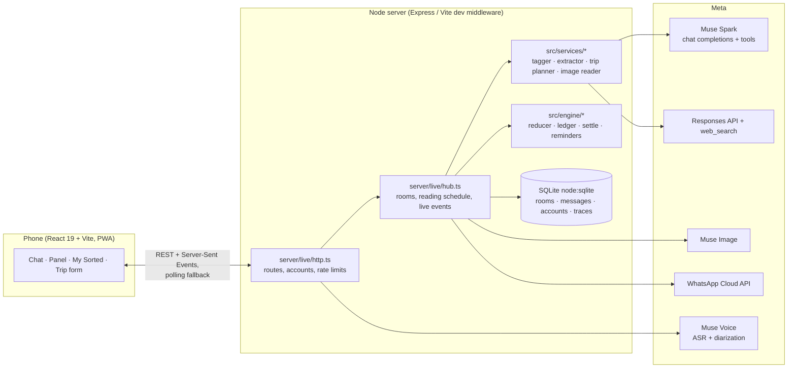

# Sorted: how it works

The model proposes, code verifies. Meta's models read messy group chats (Hinglish, Telugu-English, voice, screenshots) and propose structured facts with verbatim quotes; deterministic code checks every quote, keeps the state, and calculates every amount. Nothing the model says reaches a person unverified.

## 1. Architecture

- **Frontend:** React 19, TypeScript, Tailwind 4, installable PWA (share target for screenshots). One live connection per group (SSE, with 4 KB padding and a 4-second polling fallback because tunnels buffer streams).
- **Backend:** Node 24, TypeScript run with tsx; the same handlers run under Vite in development and Express in production.
- **Storage:** SQLite through `node:sqlite` (rooms, messages, accounts, traces), one file on a persistent disk.
- **Meta calls happen only on the server;** the Meta key never reaches a browser.

## 2. Reading a group (src/services/groupAnalyzer.ts)

1. **Only unread messages** (`state.readThrough`). Nothing is ever re-read.
2. **Topic tagging** (`topicTagger.ts`): new messages in batches of 150 (sessions split at 6-hour gaps), each batch seeing the topics so far. Muse Spark assigns each message to a topic or creates one; big plans get one topic per part ("Manali trip: stay"). `applyTagging` checks every assignment in code.
3. **Per-topic extraction** (`metaToolPipeline.ts`): each topic with new messages is read on its own, in windows of 120 with 15 messages of context, so a 900-message thread is read whole. Muse Spark calls three tools: `record_decision`, `record_commitment`, `flag_conflict`.
4. **Second looks inside the tool loop:** rejected calls go back with the reason; after a clean round, messages that say money moved (an amount and "paid / bhej diya / aa gaya / UPI kiya…", in English, Hindi, Telugu, Marathi written in English letters) with nothing recorded get one focused question; skipped promises and times get theirs.
5. **Payment sweep:** after a topic is read, any payment message still not backed by a recorded payment gets a focused look with the messages around it.
6. **Results stream in** (`onPartial`) topic by topic, so the panel fills while reading.

**When it reads** (`hub.ts` `schedule`): after 15 new messages, or 60 seconds after the chat goes quiet; immediately for @Sorted, payment screenshots and Read now. Example groups start reading their newest messages the moment an account is created. Changes people make while a read runs (confirmations, screenshots) are recorded as patches and re-applied on top of the read's results, so nothing is lost.

## 3. Verification: the model proposes, code verifies

| Check | Where | What it stops |
|---|---|---|
| Quotes must appear word for word in the cited message | `validateProposal` | Invented facts |
| A change to an agreed value raises a disagreement instead of overwriting | `eventReducer.applyProposals` | Silent overwrites |
| Promise status only moves forward; retraction needs the owner's words | reducer | Flip-flopping |
| "I paid" stays a claim until the receiver confirms (in the chat or with a button) | reducer `receivedConfirmed` | Unconfirmed money counted as paid |
| A second model checks claims and objections | `claimChecker`, `objectionChecker` | Misread objections |
| Day vs time vs amount never compared | `valueKind` | False conflicts |
| Payment screenshots: amount, names, reference, duplicate reference | `receiptVerifier` | Fake or reused screenshots |

## 4. Money, like Splitwise (src/engine/settle.ts, panel.ts, amounts.ts)

- **Debts** come from splits (bill ÷ people, or "9000 each") and from standalone promises to pay a named member (a lost bet, a loan back).
- **"Everyone"** means the people in that thread; in long threads only people who wrote at least 5% count; a stated headcount (total ÷ each) picks the most active.
- **Payments** clear the payer's debt to that person: first in the payment's own thread, then (only if that thread has no bill between them) their oldest debts in other threads. Capped at what is owed, so a payment never flips a debt.
- **One message, one transfer:** payments quoting the same message between the same two people never add up to more than that message's amount ("aa gaya 19000" is 19,000 however it is described). An amount missing from the model's call is read from the quote ("18000 + 1000 = 19000" → 19,000).
- **Loans:** money given, then "I'll give it back" in the same thread, is owed back; repayments reduce it.
- **Running totals:** "Total: Aniket owes Swapnil 1000" replaces the small items before it; its latest stated figure counts.
- **Duplicates:** the same bill filed in two topics (same collector and share, within three weeks, related titles, never different months) counts once; a recap later in the same plan counts once; a promise that is just a part of an existing share is not a second debt.
- **Each pays their own** ("apna apna") means no shared bill.
- **Outsiders** (the owner, the maid, a cricketer mentioned in passing) are never in the group's balances.
- **Currencies** are never mixed; a payment without a currency takes the currency of what it pays.
- **Netting:** per pair inside a group; settle-up is greedy minimum transfers; **never across groups**.

**Measured:** a 7,608-message Hinglish flatmates chat (7 months of rent, wifi, maid, electricity, an AC on EMI, a bike loan, IPL bets, a Manali trip) reads to exactly the story's balances (Aniket owes Kruthik ₹11,500; Swapnil owes Aniket ₹3,200; every monthly bill settled). Earlier versions of the same chat gave ₹55,863 and ₹77,423; each error was traced to a rule and fixed with a test.

## 5. Meta capabilities used

| Capability | Endpoint | Used for |
|---|---|---|
| Muse Spark (tools) | `/v1/chat/completions` with tools | Topic tagging, extraction, claim checks, @Sorted answers, private answers |
| Muse Spark (vision) | `/v1/chat/completions` with images | Payment and chat screenshots |
| Muse Voice | `/v1/asr/transcribe` (with diarization) | Voice notes, plan out loud |
| Muse Image | `/v1/images/generations` | Group Wrapped background (saved, shared across identical prompts, painted in the background) |
| Web search | `/v1/responses` with `web_search`, `include: [web_search_call.results, action.sources]` | Trip planner with real source links |
| WhatsApp Cloud API | Graph API `/messages` (text and approved templates) | Reminders to real phones |

Every call is traced (what, tokens, time) in SQLite and visible on the trace page.

## 6. Accounts, security and privacy

- Phone + 4-digit PIN; scrypt hash with salt; constant-time compare; 5 wrong PINs lock the number for 15 minutes.
- Rate limits keyed on the address the tunnel or host adds (not one a client can write): logins, sign-ups (5 per hour), new groups, joins, media, private questions, trip searches (6 per group per hour), reminders (10 per sender per hour).
- Group ownership is recorded on the server when the group is created; only the creator can delete it for everyone.
- Seats kept for a phone number can only be taken by that number's account; names Sorted could confuse ("Ravi" and "Ravi K") are refused on join.
- The Meta key stays on the server; the old browser proxy lends it only when explicitly allowed. The trace page can be locked with a key.
- WhatsApp settings are re-read when `.env.local` changes; tests never read the real file, so they can never send a real message.

## 7. Quality

- **409 automated tests** (vitest): reducer, ledger rules (each money fix has its own test), reading schedule, accounts, reminders, trip planner, screenshots, live rooms, service worker.
- **Evals** with the real Meta pipeline: six scenarios at 99% (75/76, no traps triggered); a 1,983-message chat with 19/19 facts found in the right topics; the 7,608-message Hinglish chat matching its exact balances.
- **Reviews:** independent passes over the server and the screens; confirmed findings fixed with tests, the rest listed with their plan in [FUTURE.md](FUTURE.md).

## 8. Data

Eight example groups are generated with Muse Spark from written storylines (flatmates, a Goa trip, a family, an office team, a college batch, a housing society, a gym, foodies), then read in advance by the same pipeline. The generator writes each thread in parts that continue from the previous part, so chats stay consistent. Real people's phone numbers are never in data files; they are added in the app.
