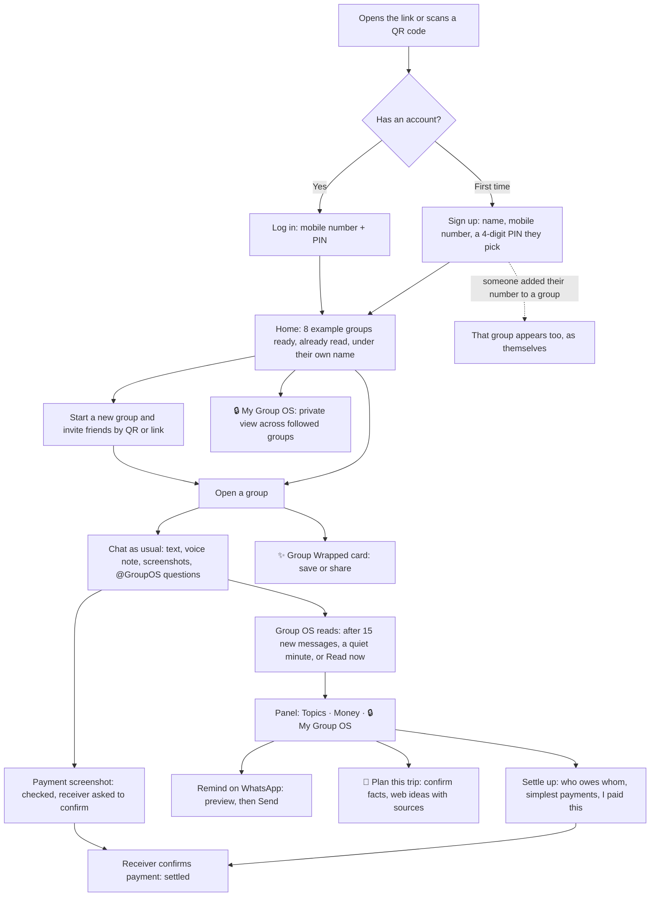

# Group OS: the user's journey

What a person sees and does, from opening the link to settling up. Every step names the screen and what Group OS does behind it.

## The whole journey at a glance

## Step by step

### 1. Getting in
| Screen | What the person does | What Group OS does |
|---|---|---|
| Login, "First time here" | Types name, mobile number (+91 or 10 digits), picks a 4-digit PIN | Creates one account per number. The PIN is stored only as a scrypt hash. |
| Login, "I have an account" | Types number + PIN | Refuses a wrong PIN; "Sign up first" for an unknown number. |
| First sign-up | Nothing | Adds 8 example groups (800 to 5,000 messages each, made-up people, marked EXAMPLE) with them in each under their own name, already read; the newest messages are read straight away. |
| Any login | Nothing | If someone added this number to a real group, that group appears, with the person in their own seat. |

### 2. Home (the group list)
- Every group shows its last message, size, topics, "you owe" / "owed" chips and open disagreements.
- **Add to / In My Group OS** chooses which groups the private view follows.
- **Delete** removes a group (for everyone if they created it, or if it is an example).
- **Start a new group** creates a group and opens a QR code and link to invite friends.

### 3. Inside a group
- Chat like WhatsApp: type, record a voice note (Muse Voice turns it into text), send a picture.
- **@GroupOS question** gets an answer from the group's own results, with quotes ("What's the villa cost per person?").
- **Status bar** shows how far Group OS has read and when it reads next (after 15 new messages, or a minute after the chat goes quiet). **Read now** reads at once.
- **Plan out loud**: record the group talking in the room; Muse Voice separates the speakers, and their words become messages.
- **Picture button**:
  - payment screenshot → recorded as "X paid Y ₹N", checked against what X owes Y, the receiver is asked to confirm;
  - the same screenshot twice → "already shared, not counted again";
  - screenshot of another chat → its messages are copied in, word for word, and read.
- **QR button** shows the invite (QR and link) to add people.
- **✨ Wrapped** makes a recap card (numbers counted in code, background painted by Muse Image) to save or share.

### 4. The panel (side icon)
- **Topics**: the chat sorted into threads (trip, rent, birthday…), each with what is decided, open questions, disagreements, promises, money and the messages behind each item (tap to jump).
- **Money**: who owes whom (netted per pair), the simplest way to settle, **I paid this**, Pay on WhatsApp / UPI, and **Remind X on WhatsApp**.
- **🔒 My Group OS** (in a group): a private chat to ask about your own money and promises; your WhatsApp number and UPI; **People in this group** (add someone by name and number).

### 5. Reminders on WhatsApp
1. Tap **Remind Aniket on WhatsApp** (Money tab or People card).
2. Group OS shows the exact message it will send: what Aniket owes, to whom, for which topics, and a link.
3. **Send** sends it from the Group OS WhatsApp number; the group sees "🔔 Kruthik sent Aniket a reminder".
4. Aniket opens the link, signs up with his number, and lands in the group as himself.

### 6. Trip planner
1. On a trip topic, tap **🧭 Plan this trip**.
2. A form shows where to, from, dates, budget and people, filled in from the chat (each with its quote). Anything the chat does not say is empty and must be filled: nothing is guessed.
3. Muse Spark searches the web with Meta's search and posts stays, travel, things to do and a money tip into the group, with real source links and "⚠️ Heads-up" if something in the plan looks off.

### 7. My Group OS (private, across groups)
- Totals across the followed groups: you owe, you are owed, disagreements, things decided. Never netted across groups.
- **Reminders**: what needs you (pay X, confirm Y's payment, your promises, disagreements).
- **Who owes whom, group by group**, each with the bills behind it.
- **Your to-do** (your promises, tick them off) and **Coming up** (dates the groups fixed).
- **Private chat**: "What do I owe overall?", answered only from your own groups.

### 8. Settling up
1. Debtor pays in their own app (UPI or WhatsApp Pay) and taps **I paid this**, or sends the payment screenshot.
2. The receiver is asked "did you get it?". Only their confirmation settles it ("received" in the chat counts too).
3. The balance updates; disputed payments stay visible as disagreements.
